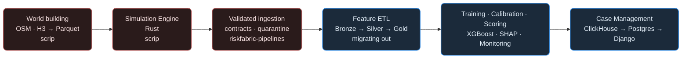

# riskfabric-ml

[](https://github.com/harshafaik/riskfabric-ml/actions/workflows/ci.yml)
[](https://github.com/harshafaik/riskfabric-ml/actions/workflows/deploy_book.yml)
[](LICENSE)
[](https://www.rust-lang.org/)
[](https://www.python.org/)
[](https://pola.rs/)
[](https://xgboost.readthedocs.io/)
[](https://clickhouse.com/)
[](https://redpanda.com/)
[](https://grafana.com/)

`riskfabric-ml` is the model and serving layer of the RiskFabric system. It consumes
analytical tables built from `scrip`'s deterministic synthetic feed and covers feature
engineering, training, calibration, real-time scoring, monitoring and analyst case review.
It does not generate data.

## Repositories

| Repository | Responsibility | Contract it emits |
| :--- | :--- | :--- |
| [`scrip`](https://github.com/harshafaik/scrip) | OpenStreetMap world building and deterministic agent simulation | dataset — five Parquet tables |
| [`riskfabric-pipelines`](https://github.com/harshafaik/riskfabric-pipelines) | Contract-validated ingestion, star schema, orchestration | validated Bronze and analytical marts |
| **riskfabric-ml** (this repository) | Feature engineering, training, calibration, scoring, monitoring, case review | model artifact and fraud scores |
| [`RiskFabric`](https://github.com/harshafaik/RiskFabric) (archived) | Original end-to-end monolith | — |

The Rust feature ETL described below still runs here. It is being replaced by
`riskfabric-pipelines`; until that migration lands, this repository is the only place
Bronze → Silver → Gold runs.

## System Pipeline



**Figure 1:** World building, simulation and validated ingestion are provided by the two
sibling repositories. The feature ETL still lives here and is being retired. Everything
from feature engineering onward is this repository's responsibility.

## Features

- **Real-time Scoring**: Kafka/Redpanda consumer with Redis feature store, XGBoost
  inference, and ClickHouse persistence.
- **Model Explainability**: SHAP global and per-profile analysis, calibration
  (Platt/Isotonic), drift simulation, and a Grafana monitoring dashboard.
- **Case Management**: Django admin panel backed by a dedicated PostgreSQL OLTP store for
  investigator review workflows.
- **Feature Engineering**: No-leak expanding-window features over Bronze/Silver/Gold
  Parquet. This layer is migrating to `riskfabric-pipelines`; the models consume whatever
  that pipeline produces.

## Tech Stack

- **Core Engine**: Rust (feature ETL)
- **Real-time Streaming**: Redpanda (Kafka-compatible) with a Python replay producer and
  scoring consumer
- **Data Processing**: Polars (batch feature engineering)
- **Data Warehouse**: Parquet (medallion ETL via Polars) → DuckDB (embedded training query
  engine)
- **Analytical Store**: ClickHouse (fraud scores, Grafana dashboards)
- **Operational Store**: PostgreSQL (case management OLTP)
- **Feature Store**: Redis (real-time feature serving)
- **Machine Learning**: XGBoost (training, inference), SHAP (explainability), Scikit-learn
  (calibration)
- **Infrastructure**: Podman/Docker Compose, Terraform (GCP deployment)
- **Docs**: mdBook (published via GitHub Actions)

## Quick Start

```bash
# Build
cargo build --release

# 1. Build the reference tables and generate a dataset with scrip (separate project).
#    Its Parquet output is exactly what the ETL expects in data/bronze/.
#    Once riskfabric-pipelines owns ingestion, this step becomes `rfp run`.
scrip fixtures --out-dir references
scrip generate --customers 3400 --seed 42 --days 365 \
  --base-date 2026-01-01T00:00:00Z \
  --input-dir references --out-dir data/bronze

# 2. Run the feature ETL (bronze → silver → gold)
cargo run --bin riskfabric-etl silver-all
cargo run --bin riskfabric-etl gold-master

# 3. Train + evaluate the XGBoost model
python src/ml/train_xgboost.py
python src/ml/test_model.py

# 4. Start the local stack
podman compose up --build -d

# 5. Replay a batch file into the streaming scorer
podman compose --profile replay run --rm replay
```

The scorer loads `data/config/runtime_thresholds.json` when present and falls back to
`0.85` otherwise. `python src/ml/compute_thresholds.py` regenerates it from the calibrated
model and the Gold snapshot.

## Project Structure

```
📁 riskfabric-ml
 │
 ├─ ⚙️ Engine
 │   ├─ src/ — Rust feature ETL (Polars): bronze → silver → gold
 │   └─ Cargo.toml
 │
 ├─ 🧠 ML & Data
 │   ├─ src/ml/ — Python ML (training, calibration, scoring, monitoring)
 │   ├─ models/ — trained model artifacts (generated)
 │   ├─ reports/ — SHAP analysis outputs
 │   └─ data/ — configs, Parquet inputs/outputs
 │
 ├─ ☁️ Ops & Infra
 │   ├─ case_admin/ — Django admin (case management)
 │   ├─ deploy/ — Terraform (GCP deployment)
 │   ├─ docker/ — ClickHouse init, Grafana provisioning
 │   └─ docker-compose.yml
 │
 └─ 📖 Docs (documentation/ — mdBook)
```

## Modules

- [Documentation index](documentation/index.md)
- [Data & Engineering](documentation/engineering_index.md)
- [Machine Learning Systems](documentation/ml_systems_index.md)
- [Infrastructure & Operations](documentation/infrastructure_index.md)
- [Conceptual Explanations](documentation/concepts_index.md)
- [Results & Monitoring](documentation/results_index.md)
- [Decisions](documentation/decisions_index.md)
- [Defunct Implementations](documentation/defunct_index.md)
- [Codebase Components](documentation/components/index.md)

## Development

```bash
cargo test
python -m compileall -q src/ml
mdbook build
```

CI runs the same three checks.

## What this is not

- Not a data generator: `scrip` owns simulation and world building.
- Not the ingestion layer: `riskfabric-pipelines` owns contracts, quarantine and the star
  schema.
- Not the archived monolith: `RiskFabric` remains as the original end-to-end reference.
- Not a hosted service: the stack is local, and the compose profile is a demo.

## License

MIT. See [LICENSE](LICENSE).

---

*Developed by harshafaik*
