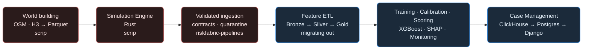

# RiskFabric

[](https://www.rust-lang.org/)
[](https://www.python.org/)
[](https://pola.rs/)
[](https://xgboost.readthedocs.io/)
[](https://clickhouse.com/)
[](https://grafana.com/)
[](https://redpanda.com/)
[](https://redis.io/)
[](https://podman.io/)
[](LICENSE)
[](https://github.com/harshafaik/riskfabric/actions/workflows/deploy_book.yml)

RiskFabric is the model and serving layer of a fraud intelligence system. It consumes analytical tables built from **scrip**'s deterministic synthetic feed and covers training, calibration, real-time scoring, monitoring and analyst case review. It does not generate data, and its data-engineering layer is moving to a dedicated pipeline repository.

## Repositories

| Repository | Responsibility | Contract it emits |
| :--- | :--- | :--- |
| `scrip` | OpenStreetMap world building and deterministic agent simulation | dataset — five Parquet tables |
| `riskfabric-pipelines` | Contract-validated ingestion, star schema, orchestration | validated Bronze and analytical marts |
| **RiskFabric** (this repository) | Training, calibration, scoring, monitoring, case review | model artifact and fraud scores |

The Rust feature ETL described below still runs here. It is being replaced by `riskfabric-pipelines`; until that migration lands, this repository is the only place Bronze → Silver → Gold runs.

## System Pipeline



**Figure 1:** System Pipeline — world building, simulation and validated ingestion are provided by the two sibling repositories. The feature ETL still lives here and is being retired. Everything from training onward is this repository's responsibility.

## ✨ Features
- **Real-time Scoring**: Kafka/Redpanda consumer with Redis feature store, XGBoost inference, and ClickHouse persistence.
- **Model Explainability**: SHAP global and per-profile analysis, calibration (Platt/Isotonic), drift simulation, and a Grafana monitoring dashboard.
- **Case Management**: Django admin panel backed by a dedicated PostgreSQL OLTP store for investigator review workflows.
- **Feature Engineering**: No-leak expanding-window features over Bronze/Silver/Gold Parquet. This layer is migrating to `riskfabric-pipelines`; the models consume whatever that pipeline produces.

## 🛠️ Tech Stack
- **Core Engine**: Rust (ETL, feature engineering)
- **Real-time Streaming**: Redpanda (Kafka-compatible) with a Python scoring consumer
- **Data Processing**: Polars (batch feature engineering)
- **Data Warehouse**: Parquet (medallion ETL via Polars) → DuckDB (embedded training query engine)
- **Analytical Store**: ClickHouse (fraud scores, Grafana dashboards)
- **Operational Store**: PostgreSQL (case management OLTP)
- **Feature Store**: Redis (real-time feature serving)
- **Machine Learning**: XGBoost (training, inference), SHAP (explainability), Scikit-learn (calibration)
- **Infrastructure**: Podman/Docker Compose, Terraform (GCP deployment)
- **Docs**: mdBook (published via GitHub Actions)

## 🚀 Quick Start

```bash
# Build
cargo build --release

# 1. Generate synthetic data with scrip (separate project).
#    Its Parquet output is exactly what the ETL expects in data/bronze/.
#    Once riskfabric-pipelines owns ingestion, this step becomes `rfp run`.
scrip generate --customers 3400 --seed 42 --days 365 \
  --base-date 2026-01-01T00:00:00Z \
  --input-dir references --out-dir data/bronze

# 2. Run the Parquet-native ETL pipeline (bronze → silver → gold)
cargo run --bin riskfabric-etl silver-all
cargo run --bin riskfabric-etl gold-master

# 3. Train + evaluate the XGBoost model
python src/ml/train_xgboost.py
python src/ml/test_model.py

# 4. Start the full stack (ClickHouse, Redpanda, Redis, scorer, case-admin, Grafana)
podman compose up --build -d
```

## 📁 Project Structure

### Root Directory

```
📁 RiskFabric
 │
 ├─ ⚙️ Engine
 │   ├─ src/ — Rust ETL (Polars): bronze → silver → gold
 │   └─ Cargo.toml
 │
 ├─ 🧠 ML & Data
 │   ├─ src/ml/ — Python ML (training, scoring, explainability)
 │   ├─ models/ — XGBoost artifacts
 │   ├─ reports/ — SHAP analysis outputs
 │   └─ data/ — Parquet inputs/outputs
 │
 ├─ ☁️ Ops & Infra
 │   ├─ case_admin/ — Django admin (case management)
 │   ├─ deploy/ — Terraform (GCP deployment)
 │   ├─ docker/ — ClickHouse init, Grafana provisioning
 │   └─ docker-compose.yml
 │
 └─ 📖 Docs (documentation/ — mdBook)
```

## Modules

- [Data & Engineering](documentation/engineering_index.md)
- [Machine Learning Systems](documentation/ml_systems_index.md)
- [Infrastructure & Operations](documentation/infrastructure_index.md)
- [Conceptual Explanations](documentation/concepts_index.md)
- [Results & Monitoring](documentation/results_index.md)
- [Decisions](documentation/decisions_index.md)
- [Defunct Implementations](documentation/defunct_index.md)
- [Codebase Components](documentation/components/index.md)

---

*Developed by harshafaik*
