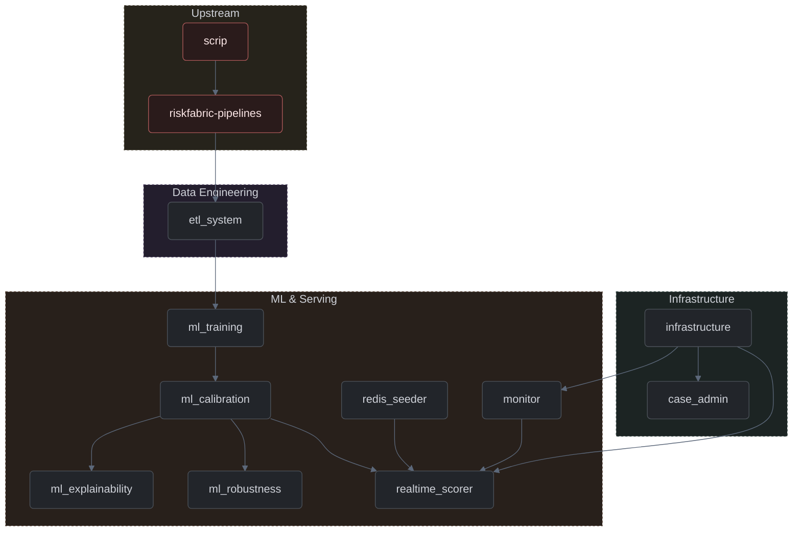

# Codebase Components

This section documents the modules that remain in `riskfabric-ml`: the Rust feature ETL,
the ML training/calibration/scoring stack, and the local infrastructure. Simulation and
world-building components moved to `scrip`; their historical documentation is under
[Defunct Implementations](../defunct_index.md).

## Component Dependency Map

**Figure 17:** Component dependency map for the remaining ML/serving surface.

## Modules

- [Feature Engineering Pipeline](etl_system.md)
- [Training Pipeline](ml_training.md)
- [Model Calibration](ml_calibration.md)
- [Real-Time Scoring Service](realtime_scorer.md)
- [Model Explainability (SHAP)](ml_explainability.md)
- [Model Robustness & Drift](ml_robustness.md)
- [Infrastructure & Local Stack](infrastructure.md)
- [Django Case Management UI](case_admin.md)
- [Redis Feature Seeder](redis_seeder.md)
- [MLflow Experiment Tracking & Model Registry](ml_tooling_mlflow.md)
- [Optuna Hyperparameter Tuning](ml_tooling_optuna.md)
- [Evidently Model Monitoring](ml_tooling_evidently.md)

Legacy data-generation components are documented under
[Defunct Implementations](../defunct_index.md).
