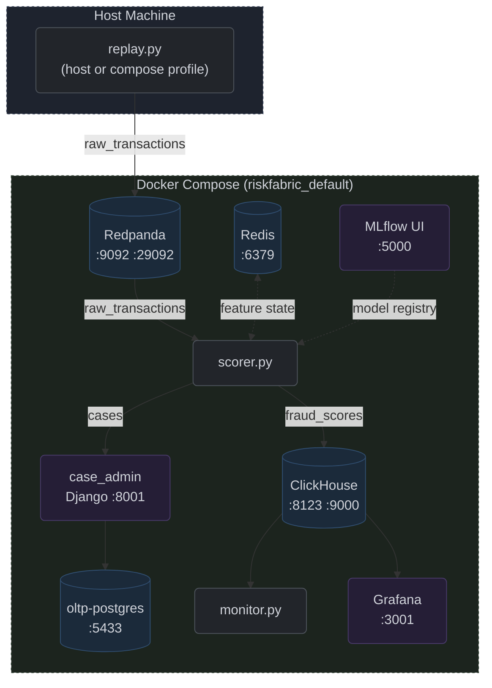

# Infrastructure & Local Service Stack

## Overview

The local service stack (`docker-compose.yml`) provisions 9 services on `riskfabric_default`: ClickHouse, Redpanda, Redis, OLTP Postgres, scorer (`scorer.py`), monitor (`monitor.py`), Grafana, MLflow UI, and Django case-admin. The `replay` profile adds a one-shot producer (`replay.py`). The Python ML services and case-management UI depend on this stack; the Rust feature ETL does not. Simulation and world building live in `scrip`, so this stack runs no world-building Postgres.

## Schema

**Figure 8:** Infrastructure Service Stack

| Service | Image | Ports | Persistence |
| :--- | :--- | :--- | :--- |
| `clickhouse` | `clickhouse/clickhouse-server:latest` | `8123`, `9000` | `clickhouse_data`, `clickhouse_logs` |
| `redpanda` | `redpandadata/redpanda:v23.2.1` | `9092` (ext), `29092` (int) | None (ephemeral) |
| `redis` | `redis:7-alpine` | `6379` | None (ephemeral) |
| `scorer` | `localhost/riskfabric_ml` (built from `Dockerfile.ml`) | — | Workspace mount `/usr/app` |
| `monitor` | `localhost/riskfabric_ml` (built from `Dockerfile.ml`) | — | Workspace mount `/usr/app` |
| `replay` | `localhost/riskfabric_ml` (profile: `replay`) | — | Workspace mount `/usr/app` |
| `grafana` | `grafana/grafana-oss:latest` | `3001` | `grafana_data` |
| `oltp-postgres` | `postgres:15-alpine` | `5433`→host | `oltp_postgres_data` |
| `case-admin` | built from `case_admin/Dockerfile` | `8001`→host | `case_admin/` mount |
| `mlflow-ui` | `ghcr.io/mlflow/mlflow:v3.14.0` | `5000` | `./mlruns` mount |

## Architecture

### Multi-Model Database Strategy
ClickHouse for append-heavy analytical queries (fraud scores), Redpanda for Kafka-compatible streaming, Redis for sub-millisecond per-card/customer state (verified: p50 120–261 µs, p99 ≤509 µs across all operations) [[See benchmarks](../performance.md)], Postgres for OLTP case management.

### Health-Check Gating
All data services health-checked (ClickHouse via `wget`, Redpanda via `rpk`, Redis via `redis-cli`, Postgres via `pg_isready`). `scorer`, `grafana`, and `case-admin` wait for `service_healthy` before startup. 5s interval, 5 retries.

### Dual Kafka Listener
Redpanda exposes port `29092` for container-to-container traffic and `9092` for host access (`replay.py`). `scorer` connects via `KAFKA_BOOTSTRAP_SERVERS=redpanda:29092`.

### Workspace Volume Mounts
`scorer`, `monitor` and `replay` mount the project at `/usr/app`; `case-admin` mounts `case_admin/` at `/usr/app`. Source changes take effect on container restart without an image rebuild. The ML image is built from `Dockerfile.ml` by the compose `build:` directive on first run.

## Current Limitations

Redpanda is ephemeral — all topic data lost on restart, preventing replay testing. Passwords hardcoded in `docker-compose.yml` and repeated across Python scripts with no `.env` support. Model artifacts (`models/`) and `data/config/runtime_thresholds.json` are generated and not committed; train the model and compute thresholds before starting the scorer.
