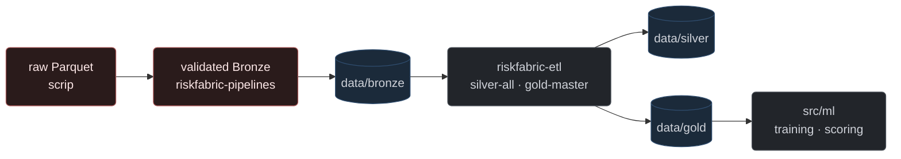

# Data Engineering & Feature ETL

This section documents the feature ETL that remains in `riskfabric-ml`. The system boundary
is: `scrip` emits the five raw Parquet tables, `riskfabric-pipelines` validates them and
builds the star schema, and this repository's Rust ETL builds the Silver and Gold feature
tables that the models consume.

## Rust Feature ETL (`src/etl`, `src/bin/riskfabric-etl.rs`)

**Figure 4:** Feature ETL boundary.

## Modules

- [Feature Engineering Pipeline](components/etl_system.md)

The geospatial reference extraction and dbt marts that used to live here moved to `scrip`
and `riskfabric-pipelines`. Their historical documentation is under
[Defunct Implementations](defunct_index.md).
